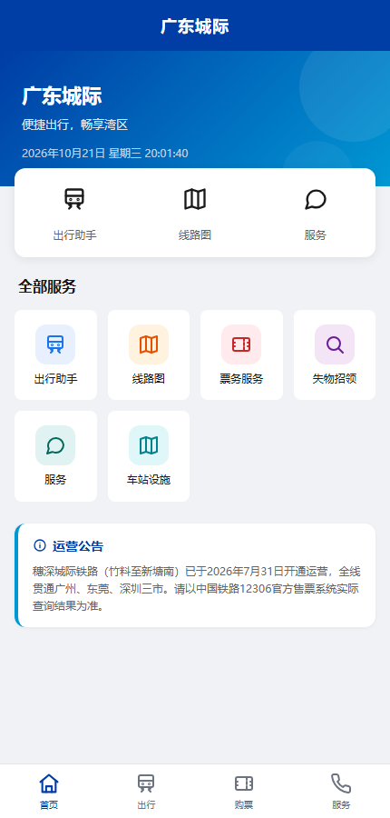
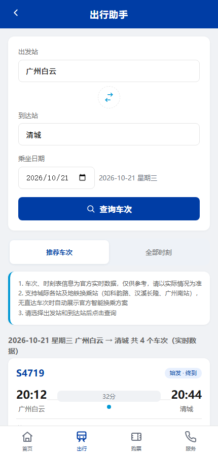
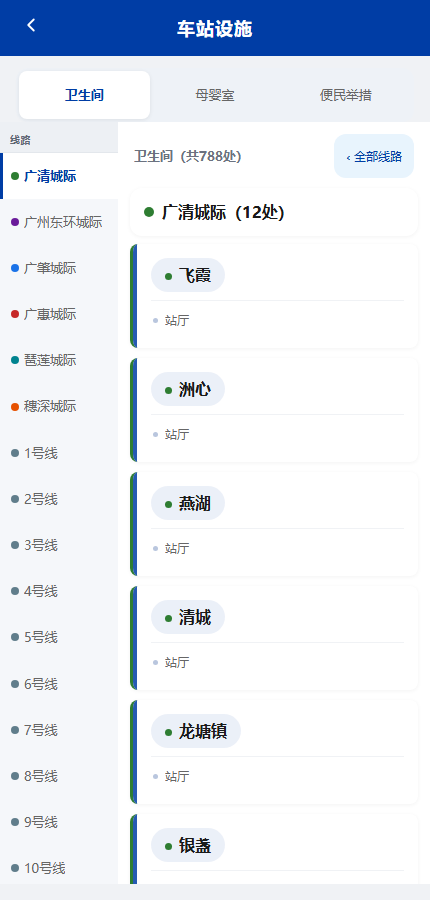

# 广东城际 · 出行助手

一个移动端优先的 **广东城际铁路出行服务 Web 应用**，仿照官方 App 的蓝白视觉，提供实时车次查询、智能换乘规划、线路图、票务指引、在线客服、失物招领和车站设施查询。

前端为原生 HTML / CSS / JavaScript，无框架、无构建步骤；后端是一个零依赖的 Node.js 本地服务器，负责静态文件服务，并代理官方接口、绕开浏览器的 CORS / Origin 限制。

> ⚠️ 本项目为个人学习与自用项目，**非官方产品**，与广东城际铁路、广州地铁集团无任何隶属关系。所有数据均来自官方公开页面与接口，请以 12306 及车站实际公告为准。

## 界面预览

| 首页 | 出行助手 | 车站设施 |
| --- | --- | --- |
|  |  |  |

截图采用 430 × 900 移动端视口，数据为查询当天的官方实时结果。

## 功能

### 出行助手
- 覆盖城际站、地铁站、有轨电车站在内的 **490+ 站点**，支持按线路浏览与拼音首字母检索
- 同时支持 `推荐车次` 与 `全部时刻` 两种视图，展示车次号、始发/终到、站台、运行时长与票价
- 无直达车次时，自动展示官方智能规划给出的 **地铁 + 城际换乘方案**，含线路配色标签、换乘站与换乘时间
- 日期选择带星期与节假日标注；当天已发车车次自动弱化显示
- 内置官方停运站校验、同枢纽站提醒（如 广州南站 ↔ 番禺），并对接口做防抖与限流保护

### 线路图 / 票务
- 展示官方线网图，支持点击查看原图，加载失败时降级为官方链接
- 提供 12306 购票入口、广州地铁乘车码 App 入口
- 购票指引、票务须知、票价查询、退改签规则等常用信息

### 服务
- 在线客服：将投诉 / 建议 / 咨询 / 表扬等工单提交至官方客服系统
- 旅客须知手风琴：乘车安全、禁限带物品、实名制、票务规则
- 服务热线一键拨打

### 失物招领
- 按关键词、线路查询官方失物招领系统，支持分页
- 在线登记遗失物品（同样通过官方工单系统提交）
- 官方服务不可用时自动回退到本地示例数据，保证界面可用

### 车站设施
- 卫生间、母婴室、便民举措三类设施查询，覆盖 780+ 条卫生间记录
- 按线路 / 站点聚合展示，线路栏快捷筛选
- 便民举措长图支持全屏查看与缩放（官方页面禁止 iframe 嵌入，改为服务端取回并解析）

## 快速开始

**环境要求：Node.js 18+**（无任何 npm 依赖）

```bash
# 进入项目目录后
node server.js
```

打开 <http://localhost:8080> 即可。**请通过 HTTP 访问，不要直接双击 `index.html`**：实时查询、工单提交和设施页面都依赖本地 `/api` 代理。

自定义端口：

```bash
# macOS / Linux
PORT=3000 node server.js

# Windows PowerShell
$env:PORT=3000; node server.js
```

也可以用 `npm start` 启动（`package.json` 已配置）。

## 项目结构

```text
.
├── index.html              # 单页应用入口（所有页面模板）
├── server.js               # 本地服务器 + 官方接口代理（零依赖）
├── css/
│   └── style.css           # 设计令牌、布局、响应式与横屏适配
├── js/
│   ├── icons.js            # 内联 SVG 图标
│   ├── station-data.js     # 地铁 / 有轨线路与站点数据
│   └── main.js             # 页面交互、数据请求与渲染
├── docs/
│   └── screenshots/        # README 截图
├── package.json
└── .gitignore
```

## 工作原理

```text
浏览器（430px 移动视口）
   │  fetch('/api/...')
   ▼
server.js（本地 Node 服务）
   │  https 请求，去掉 Origin，携带官方 key
   ▼
官方公开接口 / 页面
```

- 官方接口会拒绝带浏览器 `Origin` 的跨域请求，因此必须由服务端转发。
- 官方 `weChat/*` 接口要求一个前端硬编码的 `key`。服务端启动时从官方页面抓取，遇到 404 会自动重抓并重试一次，无需手工维护。
- 官方接口按 IP 限流，服务端对 `/api/plan`、`/api/price`、`/api/carriage` 做了 **每 10 秒最多 6 次** 的保护，超限返回 `429`，避免把本机 IP 打进临时黑名单。

### 代理接口

| 接口 | 方法 | 说明 |
| --- | --- | --- |
| `/api/ping` | GET | 健康检查，前端用它判断后端是否在线 |
| `/api/plan` | GET | 官方智能路线规划（城际直达 + 地铁换乘） |
| `/api/price` | GET | 票价查询 |
| `/api/carriage` | GET | 列车编组查询 |
| `/api/schedule` | GET | 官方已下线，固定返回 `410` |
| `/api/service-order` | POST | 在线客服 / 失物登记工单，转发官方客服系统 |
| `/api/lost-items` | GET / POST | 官方失物招领页面查询与解析 |
| `/api/facilities/query?type=卫生间` | GET | 车站设施数据 |
| `/api/facilities/wc`、`/babyroom` | GET | 官方设施 SPA 反向代理 |
| `/api/facilities/bm` | GET | 便民举措页面（服务端取回解析） |
| `/api/health/upstream` | GET | 当前官方 key 来源、抓取时间与运行时长 |

## 使用须知

- **工单是真实提交**：`/api/service-order` 会把表单内容写入官方客服系统，请勿用虚假信息反复测试。
- **隐私**：姓名、电话、地址、诉求内容仅随请求转发给官方系统，本地不做持久化存储；但请避免在公开部署环境收集他人信息。
- **部署**：本项目需要一个能运行 Node 的服务器。纯静态托管（GitHub Pages 等）只能打开界面，`/api` 功能不可用。
- 如需在手机 / 局域网访问，`server.js` 默认监听所有网卡；请勿将端口直接暴露到公网。
- 官方接口与页面结构可能随时调整，若出现查询失败，可先访问 `/api/health/upstream` 查看 key 状态。

## 开发说明

- 纯原生实现，修改 `css/style.css`、`js/main.js`、`index.html` 后刷新即可，无编译步骤。
- 检查语法：

  ```bash
  node --check server.js
  node --check js/main.js
  node --check js/icons.js
  node --check js/station-data.js
  ```

- 站点数据、地铁线路配色等均来自官方公开页面，更新时请注意保持字段一致。
- `_archive/` 为本地临时文件备份目录（已加入 `.gitignore`），可随时删除。

## 免责声明

本项目仅用于个人学习、研究与日常出行参考，不提供任何官方服务，也不代表官方立场。所有车次、票价、设施与公告信息版权归原权利人所有。使用本项目产生的任何后果由使用者自行承担，请合理控制请求频率，避免对官方服务造成影响。

## License

本项目基于 [MIT License](LICENSE) 开源。你可以自由使用、修改和分发，但需保留版权声明；软件按“原样”提供，不附带任何担保。项目中的官方数据、图片与商标归原权利人所有，不在此许可证授权范围内。
